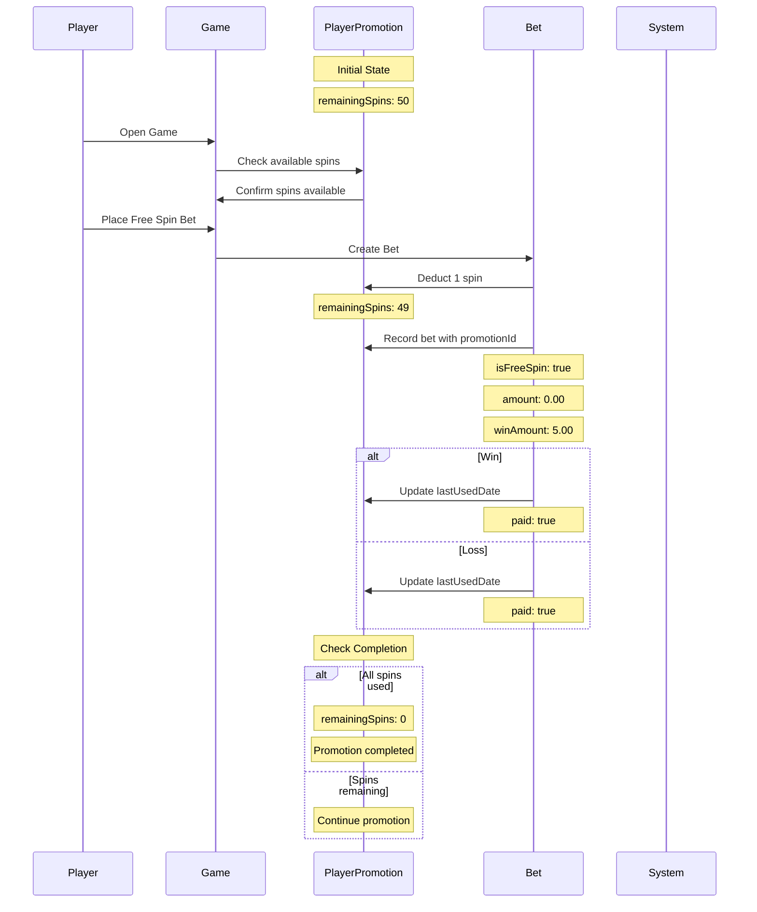
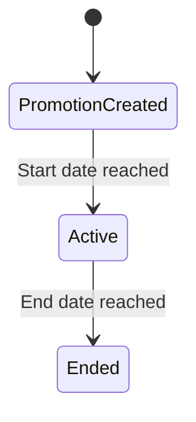
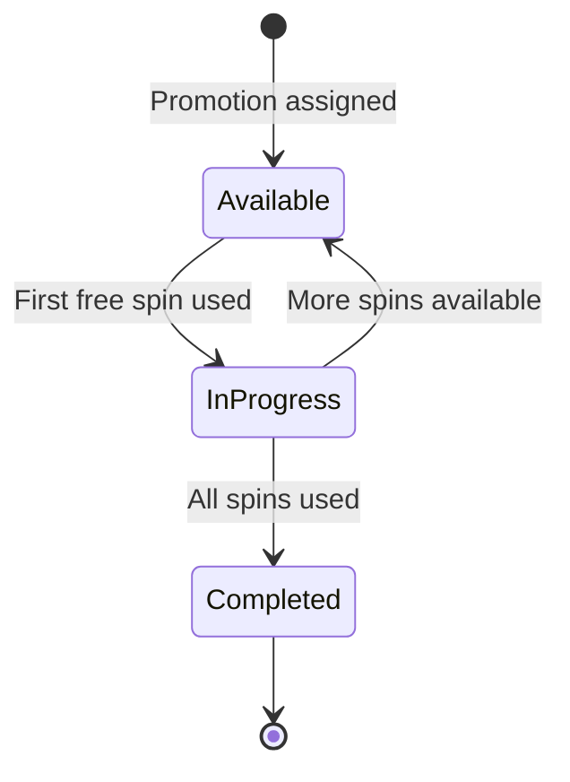
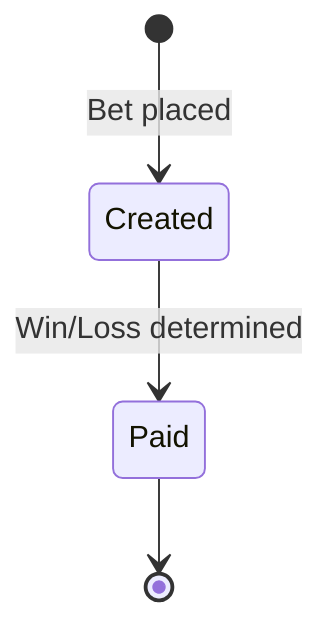

# Free Spin Count Deduction Flow

## Flow Diagram



## State Transitions

### 1. Promotion Creation


### 2. Player Promotion States


### 3. Free Spin Bet States


## Data Flow

1. **Player to Game**:
   - Player opens game
   - Game checks available spins
   - Player places free spin bet

2. **Game to Bet**:
   - Bet is created
   - Spin is deducted from PlayerPromotion
   - Bet is recorded with promotion reference

3. **Bet to PlayerPromotion**:
   - Update `lastUsedDate` after spin
   - Check completion when `remainingSpins` reaches 0

## Example Scenarios

### 1. Successful Free Spin
```javascript
// Before spin
PlayerPromotion: { remainingSpins: 50 }
Bet: { isFreeSpin: true, amount: 0.00 }

// After spin
PlayerPromotion: { remainingSpins: 49, lastUsedDate: "2024-06-01T11:00:00Z" }
Bet: { isFreeSpin: true, amount: 0.00, winAmount: 5.00, paid: true }
```

### 2. Last Free Spin
```javascript
// Before spin
PlayerPromotion: { remainingSpins: 1 }
Bet: { isFreeSpin: true, amount: 0.00 }

// After spin
PlayerPromotion: { remainingSpins: 0, lastUsedDate: "2024-06-01T11:00:00Z" }
Bet: { isFreeSpin: true, amount: 0.00, winAmount: 0.00, paid: true }
```

## Validation Rules

1. **Game Opening**:
   - Check if player has available spins
   - Verify game is eligible for promotion
   - Confirm promotion is active

2. **Spin Deduction**:
   - Must have remaining spins > 0
   - Must be within promotion dates
   - Must be for eligible game

3. **Bet Creation**:
   - Verify promotion is active
   - Verify player is eligible
   - Set isFreeSpin = true
   - Set amount = 0.00 