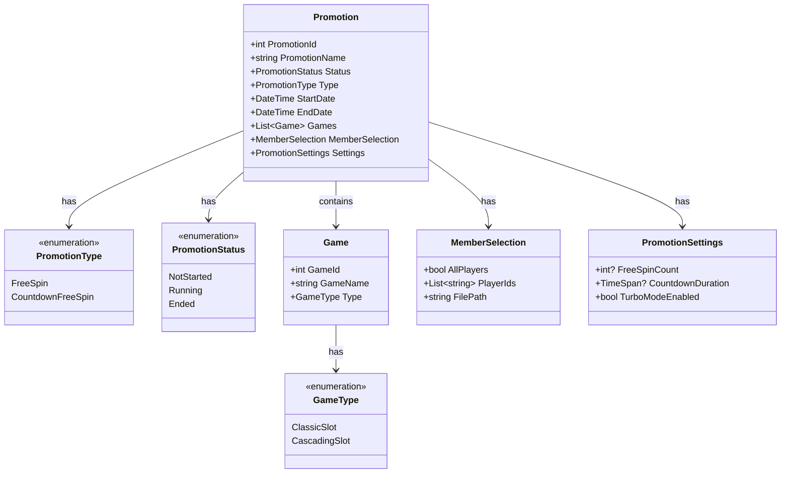

# Promotion Configuration

This diagram shows the structure and relationships for the Promotion Configuration system.

## Class Diagram

## Configuration Details

### Basic Information
- **PromotionName**: Required, unique identifier for the promotion
- **PromotionId**: System-generated unique identifier
- **Type**: 
  - FreeSpin: Standard free spins promotion
  - CountdownFreeSpin: Time-limited free spins promotion

### Time Settings
- **StartDate**: 
  - Format: MM/DD/YYYY HH:MM (24h)
  - Must be before EndDate
- **EndDate**:
  - Format: MM/DD/YYYY HH:MM (24h)
  - Must be after StartDate
- **Overlap**: Multiple promotions can have overlapping time periods

### Game Configuration
- **GameType**:
  - ClassicSlot
  - CascadingSlot
- **Games**:
  - Selected from available games
  - Ordered by GameId
  - Games can't be in multiple active promotions simultaneously

### Member Selection
- **AllPlayers**: 
  - If true, applies to all players
  - If false, uses PlayerIds list
- **PlayerIds**:
  - List of specific player IDs
  - Can be uploaded via file
- **FilePath**:
  - Optional path to player list file

### Promotion Settings
- **FreeSpinCount**:
  - Number of free spins per player
  - Only for FreeSpin type
- **CountdownDuration**:
  - Time limit for using free spins
  - Only for CountdownFreeSpin type
- **TurboModeEnabled**:
  - Allows turbo mode for CountdownFreeSpin
  - Only applicable to CountdownFreeSpin type

### Bonus Prioritization
- Promotions are prioritized by expiration date
- Earlier expiring promotions are offered first
- Players must complete one promotion before accessing others

## Validation Rules
1. EndDate must be after StartDate
2. FreeSpinCount required for FreeSpin type
3. CountdownDuration required for CountdownFreeSpin type
4. At least one game must be selected
5. Either AllPlayers must be true or PlayerIds must not be empty
6. PromotionName must be unique
7. Games can't be in multiple active promotions 